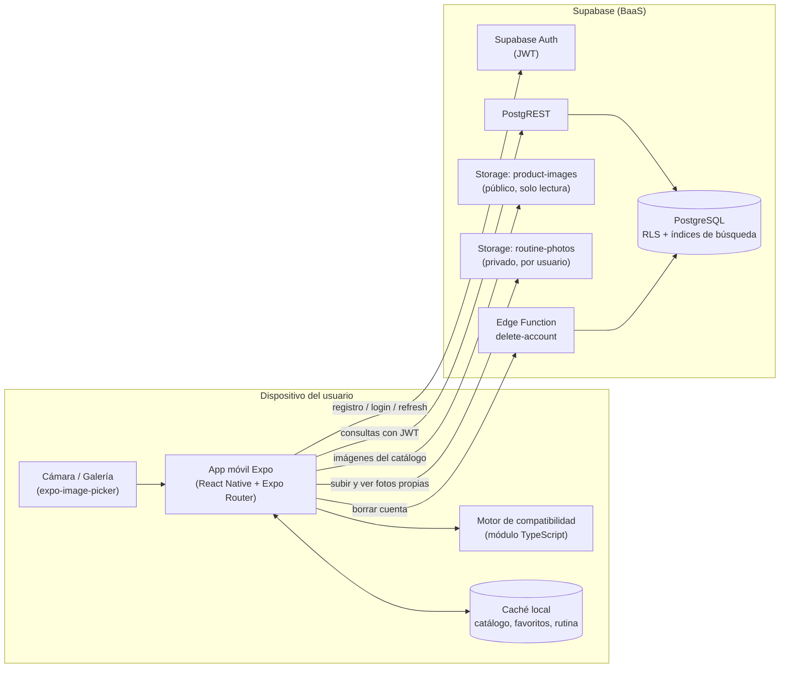
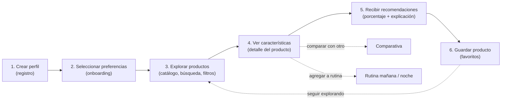
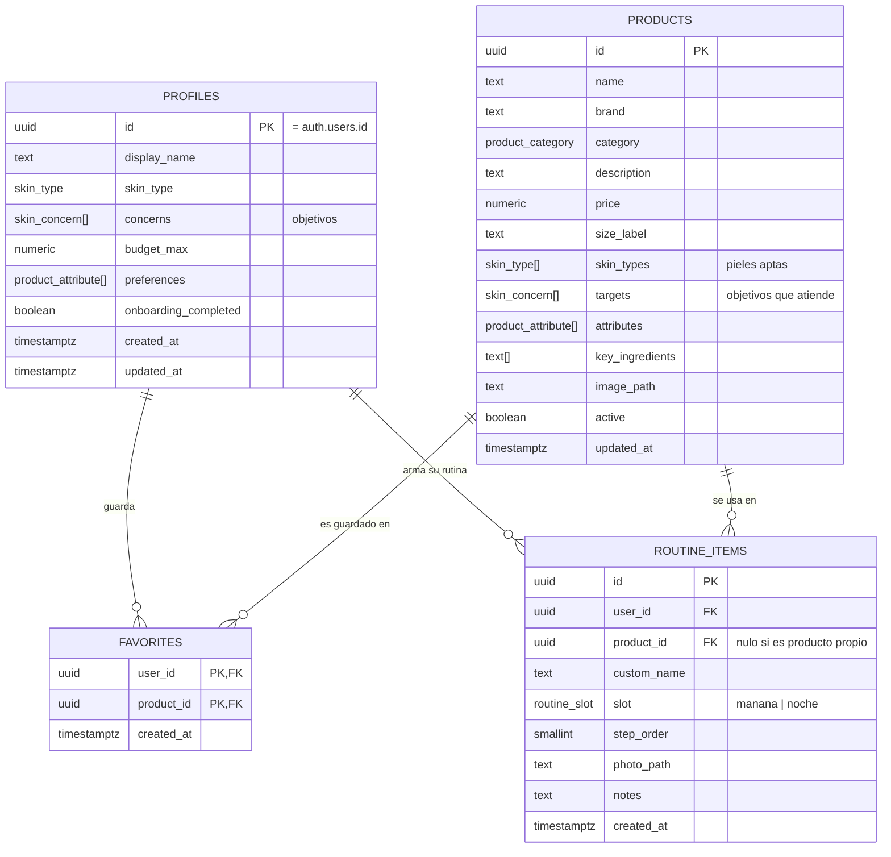
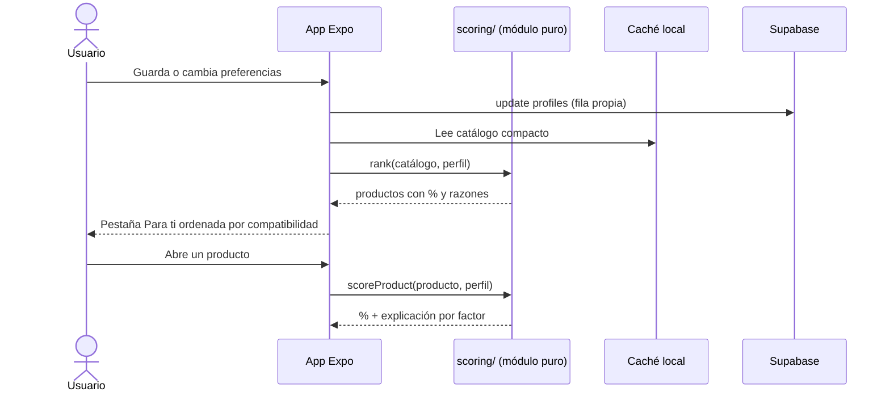

# Documento de Diseño Técnico – App de recomendaciones de skincare

Oct 6, 2026 · @Ana

## 1. Introducción y objetivos del diseño

Esta app móvil ayuda a elegir productos de cuidado de la piel: el usuario crea un perfil (tipo de piel, objetivos, presupuesto y preferencias) y la app le muestra qué productos son más compatibles, con un porcentaje y una explicación breve de por qué. Este documento define cómo construirla con Expo y Supabase: arquitectura, datos, cálculo de compatibilidad, seguridad, pruebas y despliegue.

**Alcance funcional** (tomado de tu documento de idea de proyecto):

- Perfil del usuario con tipo de piel, objetivos, presupuesto y preferencias.
- Recomendaciones con porcentaje de compatibilidad y explicación de los factores que influyeron.
- Catálogo de productos con información básica y precio, búsqueda por nombre y filtros por categoría, precio y características.
- Favoritos para consultar productos después.
- Rutina de mañana y noche, con recomendaciones basadas en lo que el usuario ya usa.
- Comparativa de dos productos similares con ventajas y desventajas.
- Cámara y galería para guardar fotos de los productos de la rutina.

**Flujo principal:** crear perfil → seleccionar preferencias → explorar productos → ver características → recibir recomendaciones → guardar producto.

**Supuestos que tomé** (ajústalos si no coinciden con tu idea):

- Un solo tipo de usuario final; el catálogo lo carga el equipo del proyecto desde el panel de Supabase en la v1, sin pantalla de administración.
- El presupuesto es un máximo por producto.
- Una sola moneda en el catálogo.
- Sin mapas ni notificaciones push, porque tu documento no los menciona; la única función nativa es cámara y galería.

### Objetivos de diseño

| Objetivo | Meta de diseño | Cómo se logra |
| --- | --- | --- |
| Interfaz sencilla e intuitiva | Llegar a la primera recomendación en pocos pasos y sin teclear mucho | Onboarding en pasos cortos, selección con chips, resultados con porcentaje visible |
| Recomendaciones claras y confiables | Que el usuario entienda por qué un producto le conviene | Puntuación con factores explícitos y explicación en lenguaje simple |
| Rendimiento offline/online | Poder consultar el catálogo, los favoritos y la rutina con mala señal | Caché local persistente y cálculo de compatibilidad en el dispositivo |
| Escalabilidad | Crecer en productos y usuarios sin rediseñar | BaaS gestionado, índices de búsqueda, catálogo paginado |
| Seguridad y privacidad | Que cada usuario vea solo sus datos y fotos | Supabase Auth, RLS por usuario, bucket de fotos privado |

## 2. Arquitectura general del sistema

La app Expo es el único cliente y todo el backend es Supabase. La decisión central es calcular la compatibilidad en el dispositivo: el catálogo se guarda en caché, así que las recomendaciones se recalculan al instante cuando el usuario cambia sus preferencias y funcionan sin conexión.

### Diagrama de alto nivel



Lectura: el usuario se autentica con Supabase Auth y cada consulta lleva su JWT; las políticas RLS en PostgreSQL limitan lo que lee y escribe. El catálogo es de lectura para todos los usuarios, mientras que perfil, favoritos, rutina y fotos son privados. Tu documento no menciona servicios externos (pagos, mapas, notificaciones), así que la v1 no depende de ninguno.

### Patrones en el frontend

| Patrón | Uso en la app |
| --- | --- |
| Component Pattern | Componentes pequeños y reutilizables (`ProductCard`, `CompatibilityBadge`, `FilterSheet`, `RoutineSlot`) sin lógica de datos adentro |
| Custom Hooks | La lógica de la app vive en hooks: `useProducts`, `useRecommendations`, `useFavorites`, `useRoutine`, `useCompare` |
| Módulo de dominio puro | `scoring/` con funciones sin dependencias de React ni de Supabase: calcula compatibilidad, explicaciones y comparativas; es fácil de probar |
| Estado del servidor | TanStack Query para consultas, caché persistente, reintentos y actualizaciones optimistas |
| Estado global de cliente | Zustand para sesión, filtros activos y borrador del onboarding; no duplica datos del servidor |
| Capa de servicios | Módulos `services/*.ts` que encapsulan `supabase-js`; los hooks no llaman a Supabase directo |

### Patrones en el backend (BaaS / serverless)

- **Seguridad declarativa:** RLS en cada tabla; cada usuario solo accede a sus filas y el catálogo es de solo lectura.
- **Datos en PostgreSQL con arreglos tipados:** tipos de piel, objetivos y características del producto se guardan como arreglos de enums con índice GIN, lo que permite filtrar con `contains` sin tablas intermedias.
- **Búsqueda en base de datos:** índice `pg_trgm` para buscar por nombre y marca con coincidencia parcial.
- **Edge Function mínima:** solo `delete-account`, porque borrar un usuario de Auth requiere la clave de servicio, que nunca debe estar en la app.
- **Migraciones versionadas:** el esquema se define en archivos SQL con la CLI de Supabase.

**Cuándo mover el cálculo al servidor.** El motor de compatibilidad en el cliente es lo más simple para un catálogo de cientos de productos. Si el catálogo crece a miles, o si necesitas ajustar los pesos sin publicar una versión nueva de la app, el mismo cálculo se puede pasar a una función SQL (RPC) sin cambiar las pantallas.

## 3. Arquitectura de navegación y componentes (Frontend Expo)

La navegación usa Expo Router con tres zonas: acceso (login y registro), onboarding de perfil y preferencias, y la app principal con cinco pestañas. El flujo de tu documento (perfil, preferencias, explorar, ver características, recomendaciones, guardar) se refleja directo en las rutas.

### Flujo principal



### Árbol de navegación

Es una propuesta basada en tu documento; ajusta nombres y pantallas a tu diseño de interfaz.

```text
app/
├── _layout.tsx                  # Root: providers (QueryClient, Zustand), guard de sesión y de perfil completo
├── (auth)/                      # Stack público
│   ├── login.tsx
│   ├── register.tsx
│   └── forgot-password.tsx
├── (onboarding)/                # Stack de perfil y preferencias (paso a paso)
│   ├── skin-type.tsx            # Tipo de piel (real o percibido)
│   ├── goals.tsx                # Objetivos
│   ├── budget.tsx               # Presupuesto máximo por producto
│   └── preferences.tsx          # Preferencias (sin fragancia, vegano, etc.)
└── (app)/                       # Protegido por sesión
    ├── (tabs)/
    │   ├── index.tsx            # Para ti: recomendaciones con % de compatibilidad
    │   ├── explore/
    │   │   └── index.tsx        # Catálogo + barra de búsqueda + filtros
    │   ├── routine.tsx          # Rutina de mañana y de noche
    │   ├── favorites.tsx        # Lista de favoritos
    │   └── profile.tsx          # Perfil, editar preferencias, cerrar sesión, borrar cuenta
    ├── product/[id].tsx         # Detalle: características, compatibilidad, favorito, agregar a rutina
    ├── compare.tsx              # Comparativa de dos productos (?a=<id>&b=<id>)
    └── (modals)/
        ├── filters.tsx          # Hoja de filtros (presentation: 'modal')
        └── routine-add.tsx      # Agregar producto a la rutina, con foto
```

- **Tabs:** Para ti, Explorar, Rutina, Favoritos y Perfil.
- **Onboarding:** si el perfil está incompleto, el layout raíz redirige al paso pendiente; las mismas pantallas se reutilizan desde Perfil para editar preferencias.
- **Modales:** filtros y agregar a rutina, para no perder el lugar en la lista.
- **Comparativa:** se abre desde el detalle de un producto eligiendo un segundo producto de la misma categoría.

### Componentes clave

| Componente | Responsabilidad | Detalles de diseño |
| --- | --- | --- |
| `CompatibilityBadge` | Mostrar el porcentaje y su explicación | Porcentaje grande con color según el rango; al tocar, despliega los factores que influyeron (piel, objetivos, presupuesto, preferencias) en una frase cada uno |
| `ProductCard` | Resumen de producto en listas | Foto, nombre, marca, precio, badge de compatibilidad y botón de favorito |
| `SearchBar` | Búsqueda por nombre | Con retardo (debounce) para no consultar en cada tecla; muestra resultados en caché sin conexión |
| `FilterSheet` | Filtros por categoría, precio y características | Chips de categoría, control de rango de precio y chips de características; el estado vive en Zustand para que sobreviva al cerrar el modal |
| `PreferenceChips` | Selección de tipo de piel, objetivos y preferencias | Reutilizable en el onboarding y en Perfil; selección única o múltiple según el campo |
| `RoutineSlot` | Lista ordenada de la rutina de mañana o de noche | Pasos reordenables, miniatura de la foto del producto y acceso rápido para agregar o quitar |
| `PhotoPicker` | Tomar o elegir una foto | Hoja con «Cámara» y «Galería»; pide permisos solo al usarse; comprime la imagen antes de subirla |
| `CompareView` | Comparar dos productos | Dos columnas con precio, compatibilidad y listas de ventajas y desventajas de cada uno |
| `FavoriteButton` | Guardar o quitar de favoritos | Cambio optimista: el corazón responde al instante y se revierte si falla |

### Manejo de estado y caché local

1. **Estado del servidor (TanStack Query):** perfil, favoritos y rutina se guardan en caché persistente en el dispositivo. El catálogo compacto (identificador, nombre, marca, categoría, precio y atributos de compatibilidad) se sincroniza de forma incremental con `updated_at`, de modo que las recomendaciones se calculan localmente sin conexión.
2. **Explorar:** la búsqueda y los filtros consultan al servidor con paginación; sin conexión se muestra lo último consultado.
3. **Estado de cliente (Zustand):** sesión, filtros activos, borrador del onboarding y estado de conexión.
4. **Mutaciones sin conexión:** favoritos y cambios de rutina son optimistas y se reenvían al volver la red. Las fotos se guardan primero como archivo local y se suben cuando hay conexión; mientras tanto se muestra la copia local.

**Regla de conflictos:** el servidor es la fuente de verdad. Los favoritos son idempotentes (una fila por usuario y producto) y la rutina tiene una restricción de unicidad, así que repetir un envío no duplica datos.

## 4. Modelado de datos y diseño de base de datos (Supabase / PostgreSQL)

El modelo tiene cuatro tablas propias: `profiles` (perfil y preferencias), `products` (catálogo), `favorites` y `routine_items`. Tipo de piel, objetivos y características del producto usan los mismos enums, que es lo que hace posible comparar perfil y producto en el cálculo de compatibilidad.

### Diagrama Entidad-Relación



### Definición de tablas

Tipos y extensiones. Los valores de los enums son una propuesta; ajústalos a las categorías, objetivos y características de tu catálogo.

```sql
create extension if not exists pg_trgm with schema extensions;

create type public.skin_type         as enum ('seca', 'grasa', 'mixta', 'normal', 'sensible');
create type public.skin_concern      as enum ('acne', 'manchas', 'antiedad', 'hidratacion', 'poros', 'enrojecimiento', 'luminosidad');
create type public.product_category  as enum ('limpiador', 'tonico', 'serum', 'hidratante', 'protector_solar', 'mascarilla', 'exfoliante', 'contorno_ojos');
create type public.product_attribute as enum ('vegano', 'cruelty_free', 'sin_fragancia', 'sin_alcohol', 'no_comedogenico', 'hipoalergenico');
create type public.routine_slot      as enum ('manana', 'noche');

create function public.set_updated_at() returns trigger
language plpgsql as $$
begin
  new.updated_at := now();
  return new;
end $$;
```

**`profiles`** (extiende `auth.users`; se crea sola al registrarse y queda incompleta hasta terminar el onboarding):

```sql
create table public.profiles (
  id                   uuid primary key references auth.users(id) on delete cascade,
  display_name         text not null default '',
  skin_type            public.skin_type,
  concerns             public.skin_concern[] not null default '{}',
  budget_max           numeric(10,2) check (budget_max > 0),
  preferences          public.product_attribute[] not null default '{}',
  onboarding_completed boolean not null default false,
  created_at           timestamptz not null default now(),
  updated_at           timestamptz not null default now()
);

create trigger profiles_updated_at
  before update on public.profiles
  for each row execute function public.set_updated_at();

create function public.handle_new_user() returns trigger
language plpgsql security definer set search_path = public as $$
begin
  insert into public.profiles (id, display_name)
  values (new.id, coalesce(new.raw_user_meta_data->>'display_name', ''));
  return new;
end $$;

create trigger on_auth_user_created
  after insert on auth.users
  for each row execute function public.handle_new_user();
```

**`products`** (catálogo; los productos no se borran, se desactivan con `active = false`):

```sql
create table public.products (
  id              uuid primary key default gen_random_uuid(),
  name            text not null check (char_length(name) between 1 and 160),
  brand           text not null,
  category        public.product_category not null,
  description     text,
  price           numeric(10,2) not null check (price >= 0),
  size_label      text,
  skin_types      public.skin_type[]         not null default '{}',
  targets         public.skin_concern[]      not null default '{}',
  attributes      public.product_attribute[] not null default '{}',
  key_ingredients text[] not null default '{}',
  image_path      text,
  active          boolean not null default true,
  created_at      timestamptz not null default now(),
  updated_at      timestamptz not null default now()
);

create trigger products_updated_at
  before update on public.products
  for each row execute function public.set_updated_at();

create index products_category_idx   on public.products (category) where active;
create index products_price_idx      on public.products (price)    where active;
create index products_updated_idx    on public.products (updated_at);
create index products_skin_types_idx on public.products using gin (skin_types);
create index products_targets_idx    on public.products using gin (targets);
create index products_attributes_idx on public.products using gin (attributes);
create index products_name_trgm_idx  on public.products using gin (name  extensions.gin_trgm_ops);
create index products_brand_trgm_idx on public.products using gin (brand extensions.gin_trgm_ops);
```

**`favorites`**:

```sql
create table public.favorites (
  user_id    uuid not null default auth.uid() references public.profiles(id) on delete cascade,
  product_id uuid not null references public.products(id) on delete cascade,
  created_at timestamptz not null default now(),
  primary key (user_id, product_id)
);

create index favorites_user_idx on public.favorites (user_id, created_at desc);
```

**`routine_items`** (producto del catálogo o producto propio con nombre libre; la foto es del usuario):

```sql
create table public.routine_items (
  id          uuid primary key default gen_random_uuid(),
  user_id     uuid not null default auth.uid() references public.profiles(id) on delete cascade,
  product_id  uuid references public.products(id) on delete restrict,
  custom_name text check (char_length(custom_name) between 1 and 120),
  slot        public.routine_slot not null,
  step_order  smallint not null default 0,
  photo_path  text,
  notes       text,
  created_at  timestamptz not null default now(),
  unique (user_id, product_id, slot),
  check (product_id is not null or custom_name is not null),
  -- la foto solo puede apuntar a la carpeta del propio usuario
  check (photo_path is null or split_part(photo_path, '/', 1) = user_id::text)
);

create index routine_user_slot_idx on public.routine_items (user_id, slot, step_order);
```

### Políticas de seguridad (RLS)

Principio: cada usuario solo ve y modifica sus propios datos; el catálogo es de lectura para cualquier usuario autenticado y solo se escribe desde el panel de Supabase o con la clave de servicio.

| Tabla | Usuario autenticado |
| --- | --- |
| `profiles` | Leer y editar solo su fila; no puede crear ni borrar perfiles |
| `products` | Solo leer (incluye inactivos, para que la caché detecte las bajas); sin escritura |
| `favorites` | Leer, agregar y quitar solo los suyos |
| `routine_items` | Leer, crear, editar y borrar solo los suyos |
| Storage `routine-photos` | Leer y escribir solo dentro de su carpeta `<user_id>/` |
| Storage `product-images` | Lectura pública; sin escritura |

```sql
alter table public.profiles      enable row level security;
alter table public.products      enable row level security;
alter table public.favorites     enable row level security;
alter table public.routine_items enable row level security;

-- profiles
create policy profiles_select_own on public.profiles
  for select to authenticated using (id = (select auth.uid()));
create policy profiles_update_own on public.profiles
  for update to authenticated
  using (id = (select auth.uid())) with check (id = (select auth.uid()));

-- products: catálogo de solo lectura
create policy products_read on public.products
  for select to authenticated using (true);  -- incluye inactivos: la caché detecta las bajas
revoke insert, update, delete on public.products from anon, authenticated;

-- favorites
create policy favorites_select_own on public.favorites
  for select to authenticated using (user_id = (select auth.uid()));
create policy favorites_insert_own on public.favorites
  for insert to authenticated with check (user_id = (select auth.uid()));
create policy favorites_delete_own on public.favorites
  for delete to authenticated using (user_id = (select auth.uid()));

-- routine_items
create policy routine_all_own on public.routine_items
  for all to authenticated
  using (user_id = (select auth.uid()))
  with check (user_id = (select auth.uid()));
```

Buckets de Storage y sus políticas (el de fotos es privado y cada usuario escribe en una carpeta con su identificador):

```sql
insert into storage.buckets (id, name, public, file_size_limit, allowed_mime_types)
values
  ('product-images', 'product-images', true,  5242880, array['image/jpeg','image/png','image/webp']),
  ('routine-photos', 'routine-photos', false, 5242880, array['image/jpeg','image/png','image/webp'])
on conflict (id) do nothing;

create policy routine_photos_select on storage.objects
  for select to authenticated
  using (bucket_id = 'routine-photos' and (storage.foldername(name))[1] = (select auth.uid())::text);
create policy routine_photos_insert on storage.objects
  for insert to authenticated
  with check (bucket_id = 'routine-photos' and (storage.foldername(name))[1] = (select auth.uid())::text);
create policy routine_photos_update on storage.objects
  for update to authenticated
  using (bucket_id = 'routine-photos' and (storage.foldername(name))[1] = (select auth.uid())::text);
create policy routine_photos_delete on storage.objects
  for delete to authenticated
  using (bucket_id = 'routine-photos' and (storage.foldername(name))[1] = (select auth.uid())::text);
```

## 5. Lógica de negocio y sistema de puntuación

El corazón de la app es el sistema de puntuación: compara el perfil del usuario con cada producto y devuelve un porcentaje de compatibilidad más una explicación por factor. Vive en un módulo TypeScript puro (`scoring/`), sin React ni Supabase, para que se calcule en el dispositivo y se pruebe con Jest. Los pesos y umbrales de esta sección son una propuesta mía; tu documento no define la fórmula, así que ajústalos a tu criterio.



### Cálculo de compatibilidad

Cada factor da un valor entre 0 y 1. Si el usuario no ha dado el dato de un factor (por ejemplo, no puso presupuesto), ese factor no se usa y los pesos de los demás se reparten entre sí. El resultado es un porcentaje redondeado.

```latex
\text{compatibilidad} = 100 \times \frac{\sum_{i \in A} w_i \, f_i}{\sum_{i \in A} w_i}
```

Donde A es el conjunto de factores aplicables, w el peso y f el valor del factor.

| Factor | Peso | Valor del factor (0 a 1) | No aplica si |
| --- | --- | --- | --- |
| Tipo de piel | 0.35 | 1 si el tipo del usuario está entre las pieles aptas del producto; 0 si no; 0.5 si el producto no especifica | El usuario no indicó tipo de piel |
| Objetivos | 0.30 | Objetivos del usuario que el producto atiende, entre el total de objetivos del usuario | El usuario no eligió objetivos |
| Presupuesto | 0.20 | 1 si el precio no supera el presupuesto; si lo supera, baja de forma lineal hasta 0 cuando cuesta el doble | El usuario no indicó presupuesto |
| Preferencias | 0.15 | Preferencias del usuario que el producto cumple, entre el total de preferencias | El usuario no eligió preferencias |

Rangos para el color del badge: 80% o más = alta, de 60% a 79% = media, menos de 60% = baja.

```typescript
// scoring/compatibility.ts
import { label, money } from './format';
import type { Product, UserProfile, FactorKey, Factor, CompatibilityResult } from './types';

export const WEIGHTS: Record<FactorKey, number> = {
  skin: 0.35,
  goals: 0.3,
  budget: 0.2,
  preferences: 0.15,
};

const overlap = <T,>(wanted: T[], have: T[]) => wanted.filter((w) => have.includes(w));

export function scoreProduct(p: Product, u: UserProfile): CompatibilityResult {
  const factors: Factor[] = [];

  if (u.skinType) {
    const known = p.skinTypes.length > 0;
    const fits = p.skinTypes.includes(u.skinType);
    factors.push({
      key: 'skin',
      value: !known ? 0.5 : fits ? 1 : 0,
      text: !known
        ? 'No indica para qué tipo de piel es.'
        : fits
          ? `Es apto para piel ${u.skinType}.`
          : `No está indicado para piel ${u.skinType}.`,
    });
  }

  if (u.concerns.length > 0) {
    const hits = overlap(u.concerns, p.targets);
    factors.push({
      key: 'goals',
      value: hits.length / u.concerns.length,
      text: hits.length
        ? `Atiende ${hits.length} de tus ${u.concerns.length} objetivos: ${hits.map(label).join(', ')}.`
        : 'No atiende ninguno de tus objetivos.',
    });
  }

  if (u.budgetMax != null) {
    const over = Math.max(0, p.price - u.budgetMax);
    factors.push({
      key: 'budget',
      value: Math.max(0, 1 - over / u.budgetMax),
      text: over === 0 ? 'Está dentro de tu presupuesto.' : `Supera tu presupuesto por ${money(over)}.`,
    });
  }

  if (u.preferences.length > 0) {
    const hits = overlap(u.preferences, p.attributes);
    factors.push({
      key: 'preferences',
      value: hits.length / u.preferences.length,
      text: hits.length
        ? `Cumple ${hits.length} de tus ${u.preferences.length} preferencias: ${hits.map(label).join(', ')}.`
        : 'No cumple ninguna de tus preferencias.',
    });
  }

  const totalWeight = factors.reduce((s, f) => s + WEIGHTS[f.key], 0);
  if (totalWeight === 0) return { score: null, factors }; // perfil sin datos: no se puntúa

  const weighted = factors.reduce((s, f) => s + WEIGHTS[f.key] * f.value, 0);
  return { score: Math.round((100 * weighted) / totalWeight), factors };
}

export type Ranked = { product: Product; score: number; factors: Factor[] };

export const rank = (products: Product[], u: UserProfile): Ranked[] =>
  products
    .flatMap((product) => {
      const r = scoreProduct(product, u);
      return r.score === null ? [] : [{ product, score: r.score, factors: r.factors }];
    })
    .sort((a, b) => b.score - a.score || a.product.price - b.product.price);
```

La explicación que ve el usuario es la lista `factors[].text`: una frase corta por factor, que es lo que pide tu documento («una explicación breve sobre los valores que influyeron»). Un perfil sin ningún dato devuelve `score: null` y la app muestra una invitación a completar el perfil en lugar de un porcentaje.

### Recomendaciones a partir de la rutina

Con los productos que el usuario registra en su rutina, la app hace dos tipos de recomendación, ambas basadas en el mismo puntaje:

- **Huecos:** categorías básicas que faltan en una rutina, con los tres productos mejor puntuados de cada una. Las categorías básicas de la propuesta son limpiador, hidratante y protector solar para la mañana, y limpiador e hidratante para la noche.
- **Mejoras:** si existe un producto de la misma categoría con una compatibilidad al menos 10 puntos mayor que el que el usuario ya usa, se le sugiere como alternativa, mostrando cuánto mejora.

Los productos propios (sin vincular al catálogo) no se evalúan; solo cuentan los productos del catálogo.

```typescript
// scoring/routine.ts
import { rank, scoreProduct } from './compatibility';
import type { Product, ProductCategory, RoutineItem, RoutineSlot, UserProfile } from './types';

const ESSENTIALS: Record<RoutineSlot, ProductCategory[]> = {
  manana: ['limpiador', 'hidratante', 'protector_solar'],
  noche: ['limpiador', 'hidratante'],
};
const UPGRADE_MIN_GAIN = 10;

export function recommendFromRoutine(routine: RoutineItem[], catalog: Product[], u: UserProfile) {
  const byId = new Map(catalog.map((p) => [p.id, p]));
  const used = new Set(routine.flatMap((r) => (r.productId ? [r.productId] : [])));
  const ranked = rank(catalog.filter((p) => !used.has(p.id)), u);

  const gaps = (Object.keys(ESSENTIALS) as RoutineSlot[]).flatMap((slot) => {
    const have = new Set(
      routine
        .filter((r) => r.slot === slot && r.productId)
        .map((r) => byId.get(r.productId!)?.category),
    );
    return ESSENTIALS[slot]
      .filter((category) => !have.has(category))
      .map((category) => ({
        slot,
        category,
        suggestions: ranked.filter((r) => r.product.category === category).slice(0, 3),
      }));
  });

  const upgrades = routine.flatMap((item) => {
    const current = item.productId ? byId.get(item.productId) : undefined;
    if (!current) return [];
    const currentScore = scoreProduct(current, u).score ?? 0;
    const better = ranked.find(
      (r) => r.product.category === current.category && r.score - currentScore >= UPGRADE_MIN_GAIN,
    );
    return better ? [{ item, current, better, gain: better.score - currentScore }] : [];
  });

  return { gaps, upgrades };
}
```

### Comparativa de dos productos

Solo se comparan productos de la misma categoría (tu documento habla de «dos productos similares»). El módulo devuelve diferencias estructuradas y la interfaz las convierte en frases de ventaja o desventaja:

| Diferencia | Se muestra como ventaja | Se muestra como desventaja |
| --- | --- | --- |
| `score` (5 puntos o más de compatibilidad) | Más compatible contigo | Menos compatible contigo |
| `price` | Cuesta menos | Cuesta más |
| `targets` (objetivos que solo atiende uno) | Además atiende: … | No atiende: … |
| `attributes` (características que solo tiene uno) | Cuenta con: … | No cuenta con: … |

```typescript
// scoring/compare.ts
import { scoreProduct } from './compatibility';
import type { Product, UserProfile, Diff } from './types';

const MIN_SCORE_GAP = 5;

// Lo que x tiene mejor que y
function betterThan(x: Product, y: Product, sx: number | null, sy: number | null): Diff[] {
  const out: Diff[] = [];
  if (sx !== null && sy !== null && sx - sy >= MIN_SCORE_GAP) out.push({ kind: 'score', delta: sx - sy });
  if (x.price < y.price) out.push({ kind: 'price', delta: y.price - x.price });
  const targets = x.targets.filter((t) => !y.targets.includes(t));
  if (targets.length) out.push({ kind: 'targets', items: targets });
  const attributes = x.attributes.filter((a) => !y.attributes.includes(a));
  if (attributes.length) out.push({ kind: 'attributes', items: attributes });
  return out;
}

export function compareProducts(a: Product, b: Product, u: UserProfile) {
  if (a.category !== b.category) throw new Error('different_category');
  const sa = scoreProduct(a, u).score;
  const sb = scoreProduct(b, u).score;
  return {
    a: { product: a, score: sa, advantages: betterThan(a, b, sa, sb), disadvantages: betterThan(b, a, sb, sa) },
    b: { product: b, score: sb, advantages: betterThan(b, a, sb, sa), disadvantages: betterThan(a, b, sa, sb) },
  };
}
```

### Reglas de favoritos y rutina

- **Favoritos:** alternar un producto inserta o borra una fila `(user_id, product_id)`; repetir la operación no genera duplicados.
- **Rutina:** un producto del catálogo aparece una sola vez por momento del día (mañana o noche), pero puede estar en ambos. El orden de pasos se guarda en `step_order` y se renumera al reordenar.
- **Foto de rutina:** opcional por producto; se sube a la carpeta del usuario en Storage y se guarda su ruta en `photo_path`.
- **Perfil incompleto:** hasta que `onboarding_completed` sea verdadero, la app redirige al onboarding y no muestra porcentajes.

## 6. Contratos de API y servicios Supabase

Todas las llamadas usan `@supabase/supabase-js` con el JWT del usuario y PostgREST; no hay funciones RPC porque el cálculo vive en la app. Cada llamada está en un módulo `services/` y la interfaz solo la ve a través de hooks. Las columnas de la base van en `snake_case` y los servicios las convierten a `camelCase` para el dominio (`skin_types` pasa a `skinTypes`).

### Cliente de Supabase

```typescript
// lib/supabase.ts
import 'react-native-url-polyfill/auto';
import AsyncStorage from '@react-native-async-storage/async-storage';
import { createClient } from '@supabase/supabase-js';
import { AppState } from 'react-native';
import type { Database } from './database.types'; // generado con la CLI de Supabase

export const supabase = createClient<Database>(
  process.env.EXPO_PUBLIC_SUPABASE_URL!,
  process.env.EXPO_PUBLIC_SUPABASE_ANON_KEY!,
  {
    auth: {
      storage: AsyncStorage,
      autoRefreshToken: true,
      persistSession: true,
      detectSessionInUrl: false,
    },
  },
);

// Renovar el token solo con la app en primer plano
AppState.addEventListener('change', (state) => {
  if (state === 'active') supabase.auth.startAutoRefresh();
  else supabase.auth.stopAutoRefresh();
});
```

### Resumen de contratos

| Operación | Llamada | Resultado |
| --- | --- | --- |
| Registro | `auth.signUp` | Usuario nuevo y perfil vacío (por trigger) |
| Login | `auth.signInWithPassword` | Sesión con JWT y refresh token |
| Recuperar sesión | `auth.getSession` + `onAuthStateChange` | Sesión persistida en el dispositivo |
| Recuperar contraseña | `auth.resetPasswordForEmail` | Correo con enlace a la app |
| Leer perfil | `from('profiles').select().eq('id', uid).single()` | Perfil y preferencias |
| Guardar perfil y preferencias | `from('profiles').update(...)` | Perfil actualizado |
| Sincronizar catálogo compacto | `from('products').select(columnas).gt('updated_at', desde)` | Productos nuevos, cambiados o desactivados |
| Buscar y filtrar productos | `from('products').select(...)` con `or`, `eq`, `lte`, `contains`, `range` | Página de productos y total |
| Detalle de producto | `from('products').select('*').eq('id', id).single()` | Producto completo |
| Favoritos | `select`, `upsert`, `delete` sobre `favorites` | Lista y cambios de favoritos |
| Rutina | `select`, `insert`, `update`, `delete` sobre `routine_items` | Rutina de mañana y noche |
| Foto de rutina | `storage.from('routine-photos').upload(...)` | Ruta del archivo en el bucket |
| Borrar cuenta | `functions.invoke('delete-account')` | Usuario, datos y fotos eliminados |

### Autenticación y perfil

```typescript
// services/auth.ts
import { supabase } from '@/lib/supabase';

export const signUp = (email: string, password: string, displayName: string) =>
  supabase.auth.signUp({ email, password, options: { data: { display_name: displayName } } });

export const signIn = (email: string, password: string) =>
  supabase.auth.signInWithPassword({ email, password });

export const signOut = () => supabase.auth.signOut();

export const resetPassword = (email: string) =>
  supabase.auth.resetPasswordForEmail(email, { redirectTo: 'skinapp://reset-password' });

// Al arrancar: restaura la sesión persistida y escucha cambios
export const restoreSession = () => supabase.auth.getSession();
export const onAuthChange = supabase.auth.onAuthStateChange.bind(supabase.auth);

// services/profile.ts
export const getProfile = (userId: string) =>
  supabase.from('profiles').select('*').eq('id', userId).single();

export const saveProfile = (userId: string, patch: ProfilePatch) =>
  supabase.from('profiles').update(patch).eq('id', userId).select().single();

export const completeOnboarding = (userId: string, data: ProfilePatch) =>
  saveProfile(userId, { ...data, onboarding_completed: true });
```

El esquema de URL `skinapp://` es un ejemplo; usa el `scheme` real de tu app (sección 7).

### Catálogo: sincronización, búsqueda y filtros

Hay dos lecturas con propósitos distintos. La sincronización trae el catálogo compacto para calcular recomendaciones en el dispositivo; la búsqueda consulta al servidor con paginación para la pantalla Explorar. Para poder detectar productos dados de baja, la sincronización también recibe los inactivos (ver la política `products_read` de la sección 4) y la app los descarta de su caché.

```typescript
// services/products.ts
const COMPACT =
  'id, name, brand, category, price, skin_types, targets, attributes, image_path, active, updated_at';
const LIST =
  'id, name, brand, category, price, size_label, skin_types, targets, attributes, image_path';

// Sincronización incremental: pasa la última marca updated_at que ya tienes
export function syncCatalog(since?: string) {
  let q = supabase.from('products').select(COMPACT).order('updated_at', { ascending: true }).limit(1000);
  if (since) q = q.gt('updated_at', since);
  return q;
}

export type ProductFilters = {
  query?: string;
  category?: ProductCategory;
  priceMin?: number;
  priceMax?: number;
  attributes?: ProductAttribute[]; // el producto debe tener todas
  skinType?: SkinType;
};

export function searchProducts(f: ProductFilters, page = 0, size = 20) {
  let q = supabase.from('products').select(LIST, { count: 'exact' }).eq('active', true);

  const text = f.query?.trim().replace(/[%,()*]/g, ' '); // evita romper el filtro or()
  if (text) q = q.or(`name.ilike.%${text}%,brand.ilike.%${text}%`);

  if (f.category) q = q.eq('category', f.category);
  if (f.priceMin != null) q = q.gte('price', f.priceMin);
  if (f.priceMax != null) q = q.lte('price', f.priceMax);
  if (f.attributes?.length) q = q.contains('attributes', f.attributes);
  if (f.skinType) q = q.contains('skin_types', [f.skinType]);

  return q.order('name').range(page * size, page * size + size - 1);
}

export const getProduct = (id: string) =>
  supabase.from('products').select('*').eq('id', id).single();

export const productImageUrl = (path: string) =>
  supabase.storage.from('product-images').getPublicUrl(path).data.publicUrl;
```

La búsqueda del servidor ordena por nombre. Si el usuario elige «ordenar por compatibilidad», la app filtra y ordena sobre el catálogo en caché, porque el porcentaje se calcula en el dispositivo.

### Favoritos

```typescript
// services/favorites.ts
export const listFavorites = () =>
  supabase.from('favorites')
    .select('created_at, product:products(*)')
    .order('created_at', { ascending: false });

// Idempotente: si ya existe, no hace nada ni falla
export const addFavorite = (productId: string) =>
  supabase.from('favorites').upsert(
    { product_id: productId },
    { onConflict: 'user_id,product_id', ignoreDuplicates: true },
  );

// RLS limita el borrado a las filas del propio usuario
export const removeFavorite = (productId: string) =>
  supabase.from('favorites').delete().eq('product_id', productId);
```

### Rutina y fotos

```typescript
// services/routine.ts
export const listRoutine = () =>
  supabase.from('routine_items')
    .select('*, product:products(id, name, brand, category, price, image_path)')
    .order('slot')
    .order('step_order');

export const addRoutineItem = (i: {
  productId?: string;
  customName?: string;
  slot: 'manana' | 'noche';
  stepOrder: number;
  photoPath?: string;
  notes?: string;
}) =>
  supabase.from('routine_items').insert({
    product_id: i.productId ?? null,
    custom_name: i.customName ?? null,
    slot: i.slot,
    step_order: i.stepOrder,
    photo_path: i.photoPath ?? null,
    notes: i.notes ?? null,
  }).select().single();

export const updateRoutineItem = (id: string, patch: RoutineItemPatch) =>
  supabase.from('routine_items').update(patch).eq('id', id).select().single();

// Rutinas cortas: una actualización por paso es suficiente
export const reorderRoutine = (items: { id: string; step_order: number }[]) =>
  Promise.all(items.map((i) => supabase.from('routine_items').update({ step_order: i.step_order }).eq('id', i.id)));

export const removeRoutineItem = async (id: string, photoPath?: string | null) => {
  if (photoPath) await supabase.storage.from('routine-photos').remove([photoPath]);
  return supabase.from('routine_items').delete().eq('id', id);
};

// services/photos.ts
import * as ImageManipulator from 'expo-image-manipulator';
import * as Crypto from 'expo-crypto';

// Redimensiona y comprime antes de subir; devuelve la ruta para guardar en photo_path
export async function uploadRoutinePhoto(userId: string, uri: string) {
  const img = await ImageManipulator.manipulateAsync(
    uri,
    [{ resize: { width: 1080 } }],
    { compress: 0.7, format: ImageManipulator.SaveFormat.JPEG },
  );
  const body = await (await fetch(img.uri)).arrayBuffer();
  const path = `${userId}/${Crypto.randomUUID()}.jpg`;

  const { error } = await supabase.storage
    .from('routine-photos')
    .upload(path, body, { contentType: 'image/jpeg', upsert: false });
  if (error) throw error;
  return path;
}

// El bucket es privado: las fotos se muestran con URL firmada de corta duración
export const signedPhotoUrls = (paths: string[]) =>
  supabase.storage.from('routine-photos').createSignedUrls(paths, 3600);
```

### Borrar cuenta

Borrar un usuario de Auth requiere la clave de servicio, que no puede estar en la app, así que se hace en una Edge Function que primero identifica al usuario con su propio JWT. Primero borra sus fotos porque, si el usuario tiene archivos en Storage, Auth no permite eliminarlo.

```typescript
// supabase/functions/delete-account/index.ts
import { createClient } from 'npm:@supabase/supabase-js@2';

Deno.serve(async (req) => {
  const authHeader = req.headers.get('Authorization');
  if (!authHeader) return new Response('unauthorized', { status: 401 });

  const url = Deno.env.get('SUPABASE_URL')!;
  const asUser = createClient(url, Deno.env.get('SUPABASE_ANON_KEY')!, {
    global: { headers: { Authorization: authHeader } },
  });
  const { data: { user }, error } = await asUser.auth.getUser();
  if (error || !user) return new Response('unauthorized', { status: 401 });

  const admin = createClient(url, Deno.env.get('SUPABASE_SERVICE_ROLE_KEY')!);

  const { data: files } = await admin.storage.from('routine-photos').list(user.id, { limit: 1000 });
  if (files?.length) {
    await admin.storage.from('routine-photos').remove(files.map((f) => `${user.id}/${f.name}`));
  }

  const { error: delError } = await admin.auth.admin.deleteUser(user.id);
  if (delError) return new Response(delError.message, { status: 500 });
  return new Response('ok');
});
```

```typescript
// services/auth.ts
export async function deleteAccount() {
  const { error } = await supabase.functions.invoke('delete-account');
  if (error) throw error;
  await supabase.auth.signOut();
}
```

Los datos de `profiles`, `favorites` y `routine_items` se eliminan solos por las claves foráneas con `ON DELETE CASCADE`.

### Errores comunes

| Error | Origen | Qué hace la app |
| --- | --- | --- |
| `23505` (unique\_violation) | Agregar a la rutina un producto que ya está en ese momento del día | Avisa «ya está en tu rutina de la mañana/noche» |
| `PGRST116` | `.single()` sin filas (perfil o producto inexistente) | Refresca la caché; si falta el perfil, reintenta o cierra sesión |
| `PGRST301` (JWT vencido) | Cualquier llamada | Intenta renovar la sesión; si falla, lleva a login |
| `42501` (RLS) | Escritura sobre datos que no son del usuario | Muestra un error genérico y refresca la sesión |
| Error de red | Cualquier llamada | Mantiene el cambio optimista en cola y reintenta al volver la conexión |
| Fallo al subir foto | Storage | Conserva la foto local y reintenta; no bloquea guardar el producto en la rutina |

## 7. Seguridad, privacidad y servicios nativos

La app guarda datos personales (tipo de piel, objetivos, rutina y fotos), así que la regla es que cada usuario vea solo lo suyo y que el cliente nunca sea la última defensa. Tu documento no incluye notificaciones ni mapas, por eso esta sección sustituye esos puntos por privacidad y por la integración de cámara y galería, que sí es tu función nativa.

### Autenticación y autorización (Supabase Auth + JWT)

- **Autenticación:** correo y contraseña con Supabase Auth. Devuelve un JWT de acceso de vida corta y un refresh token; `supabase-js` lo renueva solo y la sesión se restaura al abrir la app.
- **Autorización:** no hay roles en la v1. Todas las políticas RLS se basan en `auth.uid()`: el usuario accede a las filas con su identificador y el catálogo es de solo lectura.
- **Cuentas:** activa la confirmación de correo, una política mínima de contraseñas y los límites de tasa de Auth desde el panel de Supabase.
- **Almacenamiento del token:** `AsyncStorage` por defecto. Si quieres cifrado en el dispositivo, guarda una clave AES en `expo-secure-store` y cifra con ella el contenido de la sesión (el límite de tamaño de `SecureStore` no alcanza para la sesión completa).

| Capa | Control |
| --- | --- |
| Cliente | Solo la clave `anon` (pública) en variables `EXPO_PUBLIC_*`; nunca la clave de servicio |
| API | JWT obligatorio; el rol `anon` no tiene acceso a las tablas |
| Base de datos | RLS en todas las tablas; catálogo sin escritura; restricción que impide apuntar a fotos de otra carpeta |
| Storage | Bucket de fotos privado, carpeta por usuario, solo imágenes y límite de tamaño; URLs firmadas de corta duración |
| Edge Function | La clave de servicio solo existe ahí, como secreto de Supabase; la función identifica al usuario con su JWT antes de actuar |

### Privacidad de los datos

- **Minimización:** se piden solo los datos que alimentan la puntuación (piel, objetivos, presupuesto, preferencias) y el nombre para mostrar.
- **Fotos privadas:** solo el dueño puede verlas; la app no las comparte, por lo que no hay moderación de contenido en la v1.
- **Borrado de cuenta dentro de la app:** botón en Perfil que llama a la Edge Function `delete-account` (sección 6). Las tiendas de aplicaciones lo piden cuando una app permite crear cuenta.
- **Aviso de privacidad y consentimiento:** incluye el aviso en el registro y enlázalo desde Perfil; revisa la normativa de datos personales que te aplique, porque este documento no es asesoría legal.

### Cámara y galería (`expo-image-picker`)

La función nativa de tu documento es registrar fotos de los productos de la rutina. El flujo es: el usuario elige «Cámara» o «Galería», ve la foto al instante desde el archivo local, la app la comprime y sube a su carpeta privada, y guarda la ruta en `routine_items.photo_path`.

- **Permisos:** la cámara pide permiso al usarse; la galería se abre con el selector del sistema, que en general no requiere permiso de lectura. Si el usuario niega la cámara, la app lo explica y ofrece abrir los ajustes del sistema.
- **Peso y privacidad de la imagen:** se reduce a 1080 px de ancho y calidad 0.7 antes de subir (sección 6). Antes de publicar, verifica que el archivo resultante no conserve metadatos de ubicación (EXIF).
- **Sin conexión:** la foto se conserva localmente y se sube cuando vuelve la red.

```typescript
// lib/pickPhoto.ts
import * as ImagePicker from 'expo-image-picker';
import { Linking } from 'react-native';

export async function pickPhoto(source: 'camera' | 'gallery'): Promise<string | null> {
  if (source === 'camera') {
    const perm = await ImagePicker.requestCameraPermissionsAsync();
    if (!perm.granted) {
      if (!perm.canAskAgain) Linking.openSettings(); // la UI explica antes por qué se necesita
      return null;
    }
    const res = await ImagePicker.launchCameraAsync({ mediaTypes: ['images'], quality: 0.8 });
    return res.canceled ? null : res.assets[0].uri;
  }

  const res = await ImagePicker.launchImageLibraryAsync({
    mediaTypes: ['images'],
    quality: 0.8,
    allowsEditing: true,
    aspect: [1, 1],
  });
  return res.canceled ? null : res.assets[0].uri;
}
```

Configuración en `app.config.ts` (los textos de permiso son los que verá el usuario; el `scheme` y los identificadores son ejemplos que debes reemplazar):

```typescript
// app.config.ts
export default {
  expo: {
    name: 'SkinApp',
    slug: 'skinapp',
    scheme: 'skinapp',
    ios: { bundleIdentifier: 'com.tuequipo.skinapp' },
    android: { package: 'com.tuequipo.skinapp' },
    plugins: [
      'expo-router',
      ['expo-image-picker', {
        photosPermission: 'La app accede a tus fotos para que guardes imágenes de tus productos.',
        cameraPermission: 'La app usa la cámara para fotografiar tus productos de skincare.',
      }],
    ],
    extra: { eas: { projectId: '<EAS_PROJECT_ID>' } },
  },
};
```

Notificaciones push y mapas no forman parte de esta versión. Si más adelante quieres recordatorios de rutina («es hora de tu rutina de noche»), se pueden programar como notificaciones locales con `expo-notifications`, sin servidor ni claves externas.

## 8. Estrategia de pruebas y despliegue

La prueba más importante es la del módulo de puntuación, porque de ella depende que las recomendaciones sean correctas; después vienen los permisos por usuario en la base de datos y los componentes principales. El despliegue usa dos proyectos de Supabase (staging y producción) y tres perfiles de build en EAS.

### Pruebas

| Nivel | Qué cubre | Herramienta |
| --- | --- | --- |
| Unitarias de dominio | `scoreProduct`, `rank`, `recommendFromRoutine`, `compareProducts` | Jest (`jest-expo`) |
| Componentes | `CompatibilityBadge`, `ProductCard`, `FavoriteButton`, `FilterSheet`, `RoutineSlot` | `@testing-library/react-native` |
| Hooks | `useRecommendations`, `useFavorites`, `useRoutine` con Supabase simulado | `renderHook` + `QueryClientProvider` |
| Base de datos | RLS por usuario, restricciones y Storage | pgTAP con `supabase test db` |

Ejemplo de pruebas del cálculo de compatibilidad. Los valores esperados salen de los pesos de la sección 5, así que si cambias los pesos, actualiza estas pruebas:

```typescript
// scoring/__tests__/compatibility.test.ts
import { scoreProduct, rank } from '../compatibility';
import type { Product, UserProfile } from '../types';

const user: UserProfile = {
  skinType: 'grasa',
  concerns: ['acne', 'poros'],
  budgetMax: 300,
  preferences: ['sin_fragancia'],
};

const product: Product = {
  id: 'p1', name: 'Gel limpiador', brand: 'Marca', category: 'limpiador', price: 200,
  skinTypes: ['grasa'], targets: ['acne', 'poros'], attributes: ['sin_fragancia'],
};

describe('scoreProduct', () => {
  it('da 100 cuando cumple todos los factores', () => {
    expect(scoreProduct(product, user).score).toBe(100);
  });

  it('da 65 si el tipo de piel no coincide (pierde el peso 0.35)', () => {
    expect(scoreProduct({ ...product, skinTypes: ['seca'] }, user).score).toBe(65);
  });

  it('baja el factor de presupuesto de forma lineal al superarlo', () => {
    // precio 450 con presupuesto 300: factor 0.5 → 100 × (0.35 + 0.30 + 0.20×0.5 + 0.15) = 90
    expect(scoreProduct({ ...product, price: 450 }, user).score).toBe(90);
  });

  it('reparte los pesos entre los factores que sí tienen datos', () => {
    const onlySkin: UserProfile = { skinType: 'grasa', concerns: [], budgetMax: null, preferences: [] };
    expect(scoreProduct(product, onlySkin).score).toBe(100);
    expect(scoreProduct({ ...product, skinTypes: [] }, onlySkin).score).toBe(50); // producto sin dato
  });

  it('devuelve null con un perfil vacío', () => {
    const empty: UserProfile = { skinType: null, concerns: [], budgetMax: null, preferences: [] };
    expect(scoreProduct(product, empty).score).toBeNull();
  });

  it('incluye una explicación por factor aplicable', () => {
    expect(scoreProduct(product, user).factors).toHaveLength(4);
  });
});

describe('rank', () => {
  it('ordena por puntaje y desempata por precio menor', () => {
    const cheap = { ...product, id: 'cheap', price: 100 };
    const worse = { ...product, id: 'worse', skinTypes: ['seca'] as Product['skinTypes'] };
    expect(rank([worse, product, cheap], user).map((r) => r.product.id)).toEqual(['cheap', 'p1', 'worse']);
  });
});
```

Ejemplo de prueba de componente (el nombre y las props son ilustrativos):

```tsx
// components/__tests__/CompatibilityBadge.test.tsx
import { render, fireEvent } from '@testing-library/react-native';
import { CompatibilityBadge } from '@/components/CompatibilityBadge';

it('muestra el porcentaje y despliega la explicación al tocar', () => {
  const reasons = ['Es apto para piel grasa.', 'Está dentro de tu presupuesto.'];
  const { getByText, queryByText } = render(<CompatibilityBadge score={85} reasons={reasons} />);

  expect(getByText('85%')).toBeTruthy();
  expect(queryByText(reasons[0])).toBeNull();

  fireEvent.press(getByText('85%'));
  expect(getByText(reasons[0])).toBeTruthy();
});
```

Casos mínimos para las pruebas de base de datos (protegen la privacidad de los usuarios):

| Caso | Resultado esperado |
| --- | --- |
| Se registra un usuario nuevo | Se crea su perfil con `onboarding_completed = false` |
| El usuario A lee su perfil | Una fila |
| El usuario A lee o edita el perfil del usuario B | Cero filas |
| Usuario autenticado lee `products` | Filas del catálogo |
| Usuario intenta insertar, editar o borrar en `products` | Permiso denegado |
| El mismo favorito se agrega dos veces | Una sola fila, sin error |
| El usuario A inserta un favorito con el `user_id` de B | Rechazado por RLS |
| El usuario A lee la rutina del usuario B | Cero filas |
| Mismo producto dos veces en el mismo momento del día | Error de unicidad |
| Elemento de rutina sin `product_id` ni `custom_name` | Error de restricción |
| `photo_path` con la carpeta de otro usuario | Error de restricción |
| El usuario A lista o lee fotos de la carpeta de B en `routine-photos` | Sin acceso |

### Configuración del proyecto en VSCode

Requisitos: Node.js LTS, Git, Docker Desktop (para Supabase local) y, para compilar en tu máquina, Android Studio o Xcode.

Extensiones recomendadas: ESLint, Prettier, Expo Tools y Deno (solo para `supabase/functions`).

```bash
# 1. Crear el proyecto (incluye Expo Router y TypeScript)
npx create-expo-app@latest skinapp
cd skinapp

# 2. Dependencias de la app
npx expo install @supabase/supabase-js @react-native-async-storage/async-storage \
  react-native-url-polyfill expo-image-picker expo-image-manipulator expo-crypto \
  expo-secure-store @react-native-community/netinfo
npm i @tanstack/react-query @tanstack/react-query-persist-client \
  @tanstack/query-async-storage-persister zustand

# 3. Pruebas
npm i -D jest jest-expo @types/jest @testing-library/react-native

# 4. Supabase local
npm i -D supabase
npx supabase init
npx supabase start
npx supabase db reset            # aplica migraciones y supabase/seed.sql
npx supabase gen types typescript --local > lib/database.types.ts

# 5. Ejecutar
npx expo start
```

Expo Go sirve para desarrollar. Cuando quieras probar los permisos de cámara con los textos finales o preparar un build interno, usa un development build (`npx expo run:android` o `eas build --profile development`).

Estructura sugerida del repositorio:

```text
skinapp/
├── app/                        # Rutas de Expo Router (sección 3)
├── components/                 # ProductCard, CompatibilityBadge, FilterSheet, RoutineSlot, ...
├── hooks/                      # useRecommendations, useFavorites, useRoutine, ...
├── scoring/                    # types, compatibility, routine, compare, format
│   └── __tests__/
├── services/                   # auth, profile, products, favorites, routine, photos
├── stores/                     # Zustand: sesión, filtros, borrador de onboarding
├── lib/                        # supabase.ts, pickPhoto.ts, database.types.ts
├── supabase/
│   ├── migrations/             # 0001_tipos_tablas, 0002_rls, 0003_storage
│   ├── seed.sql                # catálogo de ejemplo para desarrollo
│   ├── tests/                  # pruebas pgTAP
│   └── functions/delete-account/
├── app.config.ts
├── eas.json
└── .env                        # solo variables públicas; no se versiona
```

Catálogo de ejemplo para desarrollo (datos ficticios; reemplázalos por tu catálogo real):

```sql
-- supabase/seed.sql
insert into public.products
  (name, brand, category, price, size_label, skin_types, targets, attributes, key_ingredients)
values
  ('Gel limpiador suave', 'Marca Ejemplo', 'limpiador', 220, '150 ml',
   '{grasa,mixta}', '{acne,poros}', '{sin_fragancia,vegano}', '{ácido salicílico}'),
  ('Crema hidratante ligera', 'Marca Ejemplo', 'hidratante', 310, '50 ml',
   '{normal,mixta,grasa}', '{hidratacion}', '{no_comedogenico}', '{glicerina,ácido hialurónico}'),
  ('Protector solar facial', 'Marca Ejemplo', 'protector_solar', 380, '50 ml',
   '{normal,mixta,grasa,sensible}', '{manchas,antiedad}', '{sin_fragancia}', '{filtros minerales}');
```

`.vscode/settings.json`:

```json
{
  "editor.formatOnSave": true,
  "editor.defaultFormatter": "esbenp.prettier-vscode",
  "editor.codeActionsOnSave": { "source.fixAll.eslint": "explicit" },
  "typescript.tsdk": "node_modules/typescript/lib",
  "deno.enablePaths": ["supabase/functions"]
}
```

Variables de entorno en `.env` (solo valores públicos):

```bash
EXPO_PUBLIC_SUPABASE_URL=http://127.0.0.1:54321
EXPO_PUBLIC_SUPABASE_ANON_KEY=<anon key que imprime `supabase start`>
```

### Build y despliegue con EAS

`eas.json` con tres perfiles: desarrollo (cliente de desarrollo), preview (instalable interno para probar con el equipo) y producción (tiendas).

```json
{
  "cli": { "version": ">= 12.0.0", "appVersionSource": "remote" },
  "build": {
    "development": { "developmentClient": true, "distribution": "internal", "channel": "development" },
    "preview":     { "distribution": "internal", "channel": "preview" },
    "production":  { "autoIncrement": true, "channel": "production" }
  },
  "submit": { "production": {} }
}
```

```bash
# Una sola vez
npm i -g eas-cli
eas login
eas init                                   # vincula el proyecto y genera el projectId
eas env:create                             # carga la URL y la anon key de Supabase por entorno

# Builds
eas build --profile development --platform android
eas build --profile preview     --platform all
eas build --profile production  --platform all

# Publicar en tiendas
eas submit --platform android
eas submit --platform ios

# Actualizaciones OTA (solo cambios de JavaScript; requiere expo-updates)
eas update --channel production --message "Ajusta los pesos de compatibilidad"
```

Backend (cada entorno apunta a su propio proyecto de Supabase). En Supabase alojado, las funciones reciben `SUPABASE_URL`, `SUPABASE_ANON_KEY` y `SUPABASE_SERVICE_ROLE_KEY` automáticamente, así que `delete-account` no necesita secretos extra:

```bash
npx supabase link --project-ref <PROJECT_REF>
npx supabase db push                                   # aplica las migraciones (tipos, tablas, RLS, buckets)
npx supabase functions deploy delete-account
```

El catálogo real se carga desde el panel de Supabase (importación CSV) o con un script que use la clave de servicio, porque los usuarios de la app no tienen permiso de escritura sobre `products`.

Orden recomendado de un lanzamiento: migraciones y función en el Supabase de producción, carga del catálogo, build de producción con las variables del entorno correcto, prueba del flujo completo en un dispositivo real (registro, onboarding, recomendaciones, favoritos, rutina con foto, borrado de cuenta) y solo entonces `eas submit`. Los cambios que toquen código nativo, como nuevas librerías o permisos, requieren un build nuevo; los que solo toquen JavaScript, como ajustar los pesos de compatibilidad, pueden ir por OTA.
